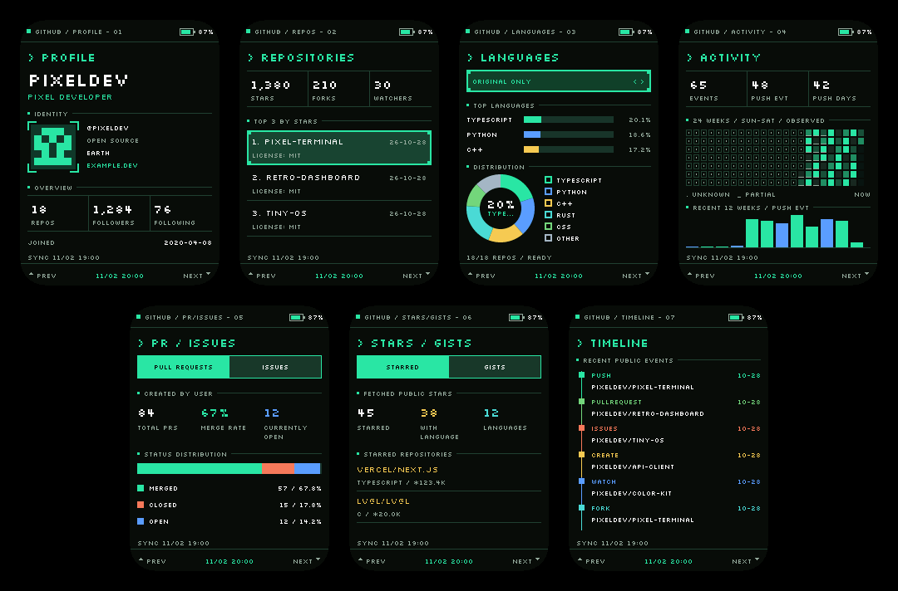

<p align="right"><a href="README.zh_CN.md">简体中文</a> · <strong>English</strong></p>

<h1 align="center">GitHub Pixel Passport</h1>
<p align="center"><strong>Your GitHub profile, ready to wear.</strong></p>
<p align="center">A pocket-sized pixel terminal for FoloToy AI Passport.</p>
<p align="center">
  <a href="https://github.com/tropical-algae/ai-passport-github-badge/releases"></a>
  <a href="https://github.com/tropical-algae/ai-passport-github-badge/actions/workflows/release.yml"></a>
  <a href="docs/hardware-design/AI_HARDWARE_DEVELOPMENT_GUIDE.md"></a>
  <a href="LICENSE"></a>
</p>

Turn an AI Passport into a personal GitHub badge: choose a public account, connect to Wi-Fi, and carry its profile, projects and activity with you. Share the profile through a QR code; keep browsing cached data when the network disappears.

<p align="center"></p>
<p align="center"><sub>Actual firmware UI rendered with native C/LVGL and synthetic data. This is a software preview, not a device photograph.</sub></p>

## Features

- **Seven compact pages** — profile, leading repositories, language distribution, observed activity, PR/issue statistics, starred projects/gists and a recent-event timeline.
- **A profile you can share** — press OK on PROFILE to reveal the account's homepage QR code, including while offline.
- **Set up from your phone** — join the badge's temporary hotspot, choose a nearby Wi-Fi network and enter any public GitHub username. No account password, token or recompilation required.
- **Background sync and local cache** — refresh without staying in settings. Profile data, avatar and accumulated history survive disconnection and restart.
- **A consistent pixel-terminal interface** — five color themes, six brightness levels, configurable screen timeout, and a matching local setup page.
- **Portable backups** — export and restore saved settings, current-account data, avatar and accumulated activity in one file.

## Get started

### 1. Flash the firmware

Use **FoloToy AI Passport with ESP32-C3, 8 MB Flash and no PSRAM**. These images target its display, buttons and board wiring; they are not generic ESP32-C3 firmware.

Download a build from [Releases](https://github.com/tropical-algae/ai-passport-github-badge/releases) and check its `SHA256SUMS.txt`. Choose the image for your situation:

| Situation | File | Flash address |
| --- | --- | --- |
| First installation, or replacing another application | `github-pixel-passport-vX.Y.Z-full.bin` | `0x0` |
| Updating this badge with a compatible partition layout | `github-pixel-passport-vX.Y.Z-app.bin` | `0x10000` |

The app image preserves the existing NVS settings and badge cache when the layout is compatible. A full image includes the bootloader and partition table and may reset saved settings. Export a backup before an upgrade; do not perform a routine full-chip erase. Never write the app image at `0x0`. Follow the release's `FLASHING.txt` for its exact filenames and commands.

### 2. Connect and configure

1. On first boot, scan the badge's Wi-Fi QR to join its temporary hotspot. Stay connected if the phone reports that it has no internet.
2. Open [http://192.168.4.1](http://192.168.4.1). Select one of the scanned **2.4 GHz** networks, or enter a hidden SSID manually.
3. Enter the Wi-Fi password, a public GitHub username and a sync interval. The default is **6 hours**; the accepted range is **1–168 hours**.
4. Save. After Wi-Fi connects and the settings are stored, the badge closes its setup QR automatically. The hotspot remains briefly so the phone can receive confirmation; GitHub sync begins after it closes.

To change these settings later, hold OK and choose **CONNECT WI-FI**. A failed connection keeps the previous saved configuration. Wi-Fi networks that require a browser login are not supported.

### 3. Use the three buttons

| Button action | Result |
| --- | --- |
| Hold UP / DOWN for 600 ms | Previous / next page |
| Short UP / DOWN | Move focus or change the current page's selection |
| Short OK | Confirm a selection; open/close the homepage QR on PROFILE |
| Hold OK | Open / close settings |
| Any button with the screen off | Wake at the saved brightness; the wake gesture does not activate anything else |

In PR/ISSUES and STARS/GISTS, move focus with UP/DOWN and select the tab with OK. Short OK closes a QR dialog. Settings have no separate exit row.

## Settings and backup

| Setting | Choices |
| --- | --- |
| BRIGHTNESS | 100%, 80%, 60%, 40%, 20%, 10%; default 100% |
| AUTO SCREEN OFF | 1, 5, 10, 30 or 60 minutes, or NEVER; default 10 minutes |
| COLOR THEME | Phosphor Green, Industrial Yellow, Ice Cyan, Amethyst, Copper Rose |
| CONNECT WI-FI | Open phone setup; wait for an active sync to finish first |
| REFETCH DATA | Start a background refresh and show success, partial completion or the failure reason |

Confirming brightness, timeout or theme returns to the corresponding settings row. Screen timeout turns off the backlight; networking and scheduled refresh continue. Leaving settings or switching pages does not cancel a refresh.

The setup page provides separate **EXPORT BACKUP** and **RESTORE BACKUP** buttons. Export includes saved Wi-Fi, username, sync interval, timezone, appearance, timeout, latest data, avatar and accumulated activity for the current account. Unsaved form edits are not exported. A successful restore replaces saved settings and data, then restarts the badge; it does not require pressing the ordinary Save button.

**Backup files contain the Wi-Fi password in plaintext. Store them privately.** Other accounts' caches and unfinished sync progress are not included.

## What the data means

The badge reads **public GitHub REST API data**, without a token. Anonymous quotas are shared by devices using the same public IP. Large accounts may need several quota windows; partial results and failures are shown explicitly, and existing cached sections remain available.

- **ACTIVITY is observed public events**, including PushEvent frequency. It is not GitHub's contribution calendar or a count of commits. The 24-week grid preserves unknown history and accumulates observations over time.
- **Starred repositories and gists are bounded samples** of the first 100 fetched entries. PR/issue statistics come from public search; incomplete responses are marked partial.
- **Avatars are cached locally.** Baseline JPEG and PNG with up to 8 bits per channel are supported, including transparency, palette, grayscale and Adam7 PNGs. 16-bit PNG, progressive JPEG, GIF and WebP are safely rejected. Rendering never fetches a live image URL; a failed replacement retains a valid avatar, or shows a placeholder if none exists.
- **Networking is direct to GitHub and its avatar CDN.** Connectivity from mainland China or restricted networks may be unreliable. Failed requests keep cached data available; the firmware does not include a proxy service.

See the [application guide](docs/development/github-badge.md) for data coverage, storage behavior and resource limits.

## Development

Use **ESP-IDF 5.5.3**, Python 3, Node.js and a host C compiler. Follow the [environment setup guide](docs/development/engineering/environment-setup.md), then run from the repository root with ESP-IDF activated:

```bash
./tools/validate.sh --static    # repository checks and host tests
./tools/validate.sh             # complete gate, firmware build and image verification

# Render the real interface with synthetic data
./tools/render_badge_ui.sh build/github-ui-preview
python3 tools/compose_badge_preview.py build/github-ui-preview/avatar assets/images/github-badge-pages.png
```

The application lives in `main/badge_*`; board support stays in `components/bsp`. The original hardware-test demos remain as reference source and are excluded from this application's build. AI-assisted contributors should start with [AGENTS.md](AGENTS.md).

Builds and host renders do not establish device acceptance. Test phone setup, physical buttons, screen wake, online/offline sync, and backup recovery on hardware. See the [architecture and validation guide](docs/development/github-badge.md) and [hardware documentation](docs/hardware-design/AI_HARDWARE_DEVELOPMENT_GUIDE.md).

## Releases

[Release](https://github.com/tropical-algae/ai-passport-github-badge/actions/workflows/release.yml) is a **manually dispatched** workflow. Its optional version input accepts an explicit release version. With the input blank, the first release uses `VERSION` (initially `0.2.5`); later releases use Conventional Commits since the previous release: `feat` increments minor, `fix`/`perf` increment patch, and `!` or `BREAKING CHANGE` increments major. Changes with no release-triggering commits, such as documentation alone, skip publication.

Each release contains the app/full images, a manifest, checksums, flashing instructions and release notes. See the [release workflow guide](docs/development/ci/CI-build-and-release.md) for validation and version rules.

## Credits and license

Built on [FoloToy AI Passport](https://gitee.com/FoloToy/ai-passport), with a dedicated pixel-terminal interface based on the project's supplied design. The setup page credits `powered by TROPICALALGAE's codex`.

This project is distributed under [GPL-3.0-only](LICENSE). The FoloToy baseline's MIT notice is preserved in [LICENSE-FoloToy](LICENSE-FoloToy). Silkscreen and Noto Sans CJK use the SIL Open Font License 1.1; their notices and sources are retained in [assets/fonts/github-badge](assets/fonts/github-badge). See the [asset notes](assets/README.md) for provenance.
