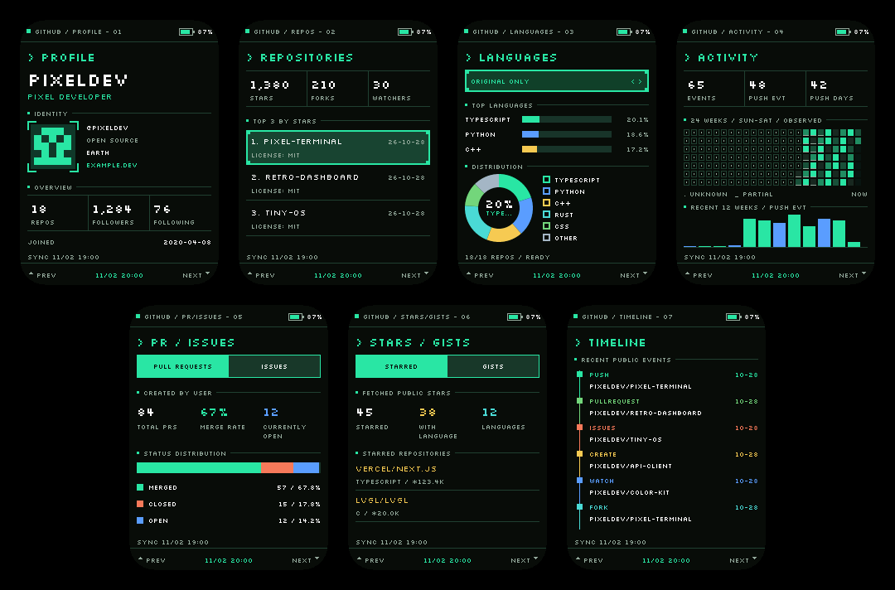

<p align="right"><strong>简体中文</strong> · <a href="README.md">English</a></p>

<h1 align="center">GitHub Pixel Passport</h1>
<p align="center"><strong>把你的 GitHub 主页，戴在身上。</strong></p>
<p align="center">为 FoloToy AI Passport 打造的口袋像素终端。</p>
<p align="center">
  <a href="https://github.com/tropical-algae/ai-passport-github-badge/releases"></a>
  <a href="https://github.com/tropical-algae/ai-passport-github-badge/actions/workflows/release.yml"></a>
  <a href="docs/hardware-design/AI_HARDWARE_DEVELOPMENT_GUIDE.zh_CN.md"></a>
  <a href="LICENSE"></a>
</p>

把 AI Passport 变成一张个人 GitHub 铭牌：选择公开账号，连接 Wi-Fi，随身展示身份、项目与活动。通过二维码分享主页，断网后仍可浏览已经缓存的数据。

<p align="center"></p>
<p align="center"><sub>由固件实际 C/LVGL 界面以 tropical-algae 名称进行本机渲染。统计与生成头像为示例数据，并非账号实际数据或设备实拍。</sub></p>

## 功能

- **七页信息展示**：身份资料、热门仓库、语言分布、已观测活动、PR/Issue 统计、收藏项目/Gists 与近期事件时间线。
- **随手分享主页**：在 PROFILE 页短按 OK 即可显示账号主页二维码，离线也能使用。
- **手机完成配置**：连接铭牌临时热点，选择附近 Wi-Fi，填写任意公开 GitHub 用户名，无需账号密码、Token 或重新编译。
- **后台同步与本地缓存**：刷新时可以退出设置；资料、头像和累计历史在断网、重启后仍然保留。
- **统一的像素终端风格**：五种配色、六档亮度、可调熄屏时间，以及同样风格的本地配置页。
- **可迁移的备份**：将已保存设置、当前账号数据、头像与累计活动导出到一个文件，也可从文件恢复。

## 快速开始

### 1. 刷入固件

适用硬件为 **FoloToy AI Passport：ESP32-C3、8 MB Flash、无 PSRAM**。固件按该设备的屏幕、按键和接线构建，不适用于任意 ESP32-C3 开发板。

从 [Releases](https://github.com/tropical-algae/ai-passport-github-badge/releases) 下载固件，并核对 `SHA256SUMS.txt`。根据使用场景选择：

| 场景 | 文件 | 写入地址 |
| --- | --- | --- |
| 首次安装，或从其他应用切换过来 | `github-pixel-passport-vX.Y.Z-full.bin` | `0x0` |
| 已安装本铭牌，且分区布局兼容时升级 | `github-pixel-passport-vX.Y.Z-app.bin` | `0x10000` |

分区布局兼容时，app 镜像保留 NVS 设置与铭牌缓存。full 镜像包含引导程序和分区表，可能重置已有设置。升级前请导出备份，通常无需整片擦除；不要把 app 镜像写入 `0x0`。具体文件名和命令以该版本的 `FLASHING.txt` 为准。

### 2. 联网并配置

1. 首次启动时，可扫描 Wi-Fi 二维码，或在手机上选择屏幕中的热点名称并输入显示的密码。如果手机提示无互联网，请保持连接。
2. 打开 [http://192.168.4.1](http://192.168.4.1)，选择扫描到的 **2.4 GHz** Wi-Fi，或手动输入隐藏网络的名称。
3. 填写 Wi-Fi 密码、公开 GitHub 用户名与同步间隔。默认 **6 小时**，可选范围为 **1–168 小时**。
4. 保存。铭牌尝试连接 Wi-Fi 并保存设置期间，热点保持开启。成功结果返回手机后，关闭配网二维码和热点；配网处理结束后开始同步 GitHub 数据。

以后可长按 OK，选择 **CONNECT WI-FI** 重新配置。关闭配网弹窗会关闭热点；已经提交的连接与保存任务继续执行，结果在铭牌上提示。配网失败时保留原来的已保存配置。配网弹窗打开期间暂停自动熄屏。需要通过浏览器登录认证的 Wi-Fi 暂不支持。

每次重新开启热点都会生成新密码。如果手机沿用旧密码且不弹出输入框，请先忽略已保存的铭牌网络，再重新选择并输入屏幕上的当前密码。配网热点一次只允许一台手机连接。

### 3. 使用三个按键

| 按键操作 | 效果 |
| --- | --- |
| 长按 UP / DOWN 600 毫秒 | 上一页 / 下一页 |
| 短按 UP / DOWN | 移动焦点，或切换当前页面的选项 |
| 短按 OK | 确认选项；在 PROFILE 页打开/关闭主页二维码 |
| 长按 OK | 进入 / 退出设置 |
| 熄屏后按任意键 | 按已保存亮度唤醒；整次唤醒手势不会额外触发其他操作 |

在 PR/ISSUES 与 STARS/GISTS 页，先用 UP/DOWN 移动焦点，再按 OK 切换标签。短按 OK 可关闭二维码弹窗。设置列表没有单独的退出项。

## 设置与备份

| 设置项 | 可选值 |
| --- | --- |
| BRIGHTNESS | 100%、80%、60%、40%、20%、10%；默认 100% |
| AUTO SCREEN OFF | 1、5、10、30、60 分钟，或 NEVER；默认 10 分钟 |
| COLOR THEME | Phosphor Green、Industrial Yellow、Ice Cyan、Amethyst、Copper Rose |
| CONNECT WI-FI | 打开手机配置；若正在同步，则等待同步完成后开启 |
| REFETCH DATA | 后台刷新，并显示成功、部分完成或具体失败原因 |

确认亮度、熄屏时间或主题后，会回到对应的设置行。自动熄屏会停止背光输出、让 LCD 进入休眠并暂停显示刷新；联网与定时同步继续运行。唤醒时先恢复屏幕并重绘，再开启已保存的亮度。退出设置或切换页面不会取消刷新。

配置页有独立的 **EXPORT BACKUP** 和 **RESTORE BACKUP** 按钮。备份包含已保存的 Wi-Fi、用户名、同步间隔、时区、外观、熄屏时间，以及当前账号最新数据、头像和累计活动；不会导出表单中尚未保存的修改。恢复成功后替换已保存设置与数据，并自动重启，无需再按普通的保存按钮。

**备份文件包含明文 Wi-Fi 密码，请妥善保管。** 其他账号的缓存与尚未完成的同步进度不会包含在内。

## 数据含义与边界

铭牌使用**公开 GitHub REST API 数据**，无需 Token。同一公网 IP 下的设备共享匿名请求额度；大型账号可能需要跨多个额度窗口才能完成采集。部分结果与错误会明确标记，已有缓存仍可浏览。

- **ACTIVITY 统计已观测到的公开事件**，包括 PushEvent 频次，不等同于 GitHub 贡献日历或提交次数。24 周热力图保留未知历史，并随着后续同步逐步积累。
- **收藏仓库和 Gists 是有上限的样本**：最多读取前 100 条。PR/Issue 统计来自公开搜索，不完整的响应会标为部分数据。
- **头像缓存在本地**，支持基线 JPEG 与每通道不超过 8 位的 PNG，包括透明、调色板、灰度和 Adam7 交错 PNG。16 位 PNG、渐进 JPEG、GIF 和 WebP 会安全拒绝。渲染不实时请求图片 URL；替换失败时保留有效旧头像，没有可用头像时显示占位图。
- **设备直接访问 GitHub 及头像 CDN**。中国大陆或受限网络下连接可能不稳定；请求失败时仍保留缓存，固件不内置代理服务。

完整的数据覆盖范围、存储行为和资源限制见[应用说明](docs/development/github-badge.zh_CN.md)。

## 本地开发

开发环境使用 **ESP-IDF 5.5.3**、Python 3、Node.js 与主机 C 编译器。按[环境搭建指南](docs/development/engineering/environment-setup.zh_CN.md)完成准备，激活 ESP-IDF 后在仓库根目录运行：

```bash
./tools/validate.sh --static    # 仓库检查与主机测试
./tools/validate.sh             # 完整检查、固件构建与镜像验证

# 用合成数据渲染实际界面
BADGE_PREVIEW_USERNAME=tropical-algae ./tools/render_badge_ui.sh build/github-ui-preview
python3 tools/compose_badge_preview.py build/github-ui-preview/avatar assets/images/github-badge-pages.png
```

应用代码位于 `main/badge_*`，板级支持位于 `components/bsp`。原有硬件测试 Demo 保留为参考源码，不参与本应用构建。使用 AI 协作开发前请阅读 [AGENTS.zh_CN.md](AGENTS.zh_CN.md)。

构建成功和本机渲染不代表真机验收完成。手机配网、实体按键、熄屏唤醒、在线/离线同步与备份恢复仍需在硬件上验证。详见[架构与验证说明](docs/development/github-badge.zh_CN.md)及[硬件文档](docs/hardware-design/AI_HARDWARE_DEVELOPMENT_GUIDE.zh_CN.md)。

## 版本发布

[Release](https://github.com/tropical-algae/ai-passport-github-badge/actions/workflows/release.yml) 工作流仅支持**手动触发**，可填写明确版本号。留空时，首次发布使用 `VERSION`（初始为 `0.2.5`）；后续按上次发布以来的 Conventional Commits 推导：`feat` 升次版本，`fix`/`perf` 升补丁版本，`!` 或 `BREAKING CHANGE` 升主版本。只有文档等不触发版本升级的提交时，跳过发布。

每次发布包含 app/full 镜像、清单、校验和、刷写说明和发布说明。具体校验及版本规则见[发布工作流指南](docs/development/ci/CI-build-and-release.zh_CN.md)。

## 致谢与许可

基于 [FoloToy AI Passport](https://gitee.com/FoloToy/ai-passport) 开发，并依据本项目提供的设计稿实现独立的像素终端界面。配置页保留署名 `powered by TROPICALALGAE's codex`。

本项目采用 [GPL-3.0-only](LICENSE)。FoloToy 基础项目的 MIT 声明保留在 [LICENSE-FoloToy](LICENSE-FoloToy)。Silkscreen 与 Noto Sans CJK 使用 SIL Open Font License 1.1，许可与来源保存在 [assets/fonts/github-badge](assets/fonts/github-badge)。资源来源详见[资源说明](assets/README.zh_CN.md)。
